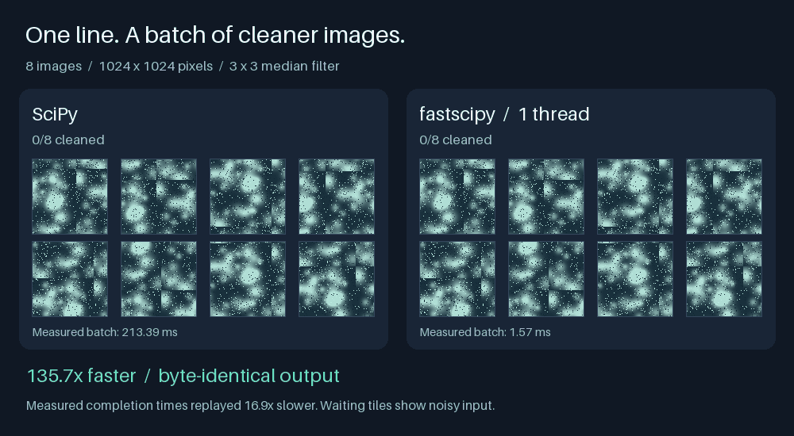

# fastscipy

**Faster SciPy calls. The same results, byte for byte.**

Rust kernels and shared thread pools accelerate supported calls. Everything
else stays with SciPy.

```python
import fastscipy
fastscipy.patch()

from scipy import ndimage
clean = ndimage.median_filter(image, size=3)
```



*Run on a MacBook Pro with M5 Pro.*

[Explore nine more examples →](examples/README.md)

## Install

Requires a [Rust toolchain](https://rustup.rs). Not on PyPI yet.

```sh
pip install git+https://github.com/michael-L-i/fastscipy
```

**Experimental: macOS Apple Silicon · SciPy 1.18 · Python 3.12–3.14.**
Unsupported platforms and versions stay unpatched.

Call `patch()` before importing libraries that use SciPy.
Use `patch(threads=4)` to choose a thread budget, `status()` to see what's enabled,
and `unpatch()` to restore SciPy.

## Performance

Geometric-mean speedups over unpatched SciPy, measured on an Apple M5 Pro.

| Area | Cases | 1 thread | 18 threads |
|---|---:|---:|---:|
| linalg — stacks of small matrices | 19 | 10.0× | 75.9× |
| ndimage | 41 | 13.3× | 68.2× |
| interpolate | 12 | 15.6× | 44.3× |
| csgraph | 9 | 5.8× | 15.5× |
| signal | 22 | 4.7× | 12.4× |
| sparse | 16 | 4.7× | 11.9× |
| stats | 46 | 7.0× | 9.3× |
| special | 32 | 1.0× | 7.4× |
| spatial | 8 | 1.0× | 6.7× |
| integrate | 3 | 1.6× | 1.6× |
| optimize | 3 | 1.1× | 1.1× |

Published run: 2026-10-18, SciPy 1.18.1, Python 3.13, release build; controls
excluded. Results vary by workload and hardware.
[Full results](bench/RESULTS.md) · [Latest expansion results](bench/README.md)

## More

[Coverage](docs/coverage.md) · [How it works](docs/design.md) ·
[Demo source](examples/median_filter.py) · [Contributing](CONTRIBUTING.md)

BSD-3-Clause. SciPy ports retain [SciPy's license](LICENSES/scipy-LICENSE.txt).
Independent of the SciPy project.
