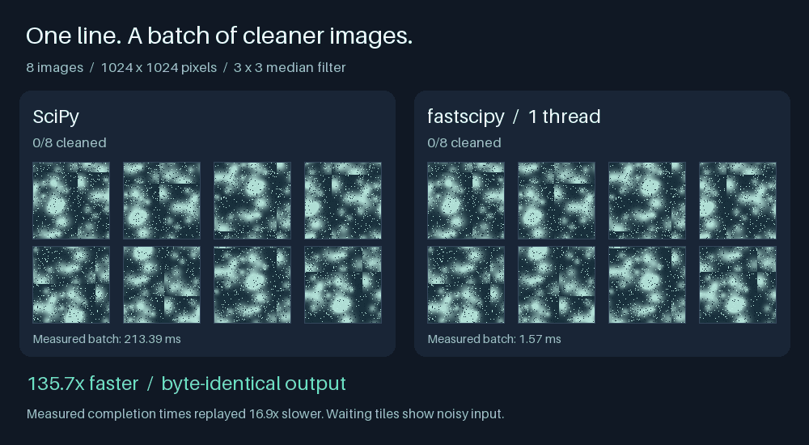

# fastscipy

**Faster SciPy calls. SciPy-compatible results.**

Portable Rust kernels and shared thread pools accelerate supported calls.
Everything else stays with SciPy.

**0.1.0a5 release preparation:** the command below targets the forthcoming
release. The currently published release is 0.1.0a4.

```sh
python -m pip install --only-binary=:all: fastscipy==0.1.0a5
```

```python
import numpy as np
import fastscipy

fastscipy.patch(threads=2)

from scipy import ndimage

image = np.random.default_rng(0).normal(size=(256, 256))
clean = ndimage.median_filter(image, size=3)
```



*Demo recorded on a MacBook Pro with M5 Pro.*

[Explore eight more examples →](https://github.com/michael-L-i/fastscipy/blob/main/examples/README.md#eight-everyday-scipy-tasks-faster)

[Try five interactive notebooks →](https://github.com/michael-L-i/fastscipy/blob/main/examples/README.md#interactive-notebooks)

## Install and use

The forthcoming **0.1.0a5** targets **Python 3.9–3.15 · SciPy 1.10–1.18**.
Dependency metadata permits **NumPy 1.19.5–<2.8**, subject to SciPy's own
requirements; acceleration requires stable **NumPy <2.6**. A permitted
installation is not a claim that every dependency combination is qualified.

The planned 53-wheel set needs no Rust and covers **x86_64 and ARM64** on
Linux (glibc 2.28+ or musl 1.2+), macOS 14+, and Windows:

| Platform | Python versions in the planned wheel set |
|---|---|
| macOS arm64 / x86_64 | 3.9–3.15 |
| Linux glibc arm64 / x86_64 | 3.9–3.15 |
| Linux musl x86_64 | 3.9–3.15 |
| Linux musl arm64 | 3.10–3.15 |
| Windows x86_64 | 3.9–3.15 |
| Windows arm64 | 3.11–3.15 |

Python 3.9 on musl arm64 and Python 3.9–3.10 on Windows arm64 lack the
selected SciPy dependency wheels. Older-stack release qualification covers
`ndimage`, `special`, and `spatial`; SciPy 1.18 retains the full component
gate. Unsupported calls fall back to SciPy. The full 53-wheel rehearsal
passed with publishing disabled; a5 still requires its own tagged validation
and publication. [Dependency pins, evidence, and limitations →](https://github.com/michael-L-i/fastscipy/blob/main/docs/platforms.md#compatibility-candidates)

Call `patch()` before importing libraries that use SciPy. The default thread
budget uses all cores; choose `threads=2` (as above) to bound fastscipy's work.
BLAS has its own thread settings.

```python
print(fastscipy.status())  # component: "on" or "off: <reason>"
print(fastscipy.stats())   # counters showing actual fast-path use
fastscipy.unpatch()        # restore SciPy
```

An enabled component still forwards unsupported inputs and options to SciPy.
An unavailable component stays off with a reason in `status()`. See
[coverage](https://github.com/michael-L-i/fastscipy/blob/main/docs/coverage.md)
for the supported calls and older-stack restrictions.

## Performance across platforms

Geometric-mean speedups at **two threads**, with BLAS limited to one.
These historical portability checkpoints use Python 3.13, NumPy 2.5.4, and SciPy 1.18.1;
each comparison uses the same machine and inputs.

| Platform | ndimage | stats | linalg |
|---|---:|---:|---:|
| Linux x86_64 · glibc | 15.1× | 5.9× | 3.9× |
| Linux ARM64 · glibc | 13.2× | 6.5× | 4.0× |
| Linux x86_64 · musl | 12.3× | 6.0× | 5.1× |
| Linux ARM64 · musl | 11.8× | 6.4× | 4.0× |
| macOS Apple Silicon | 16.9× | 5.9× | 4.8× |
| macOS Intel | 13.0× | 5.7× | 6.5× |
| Windows x86_64 | 11.7× | 5.9× | 4.7× |
| Windows ARM64 | 11.7× | 6.4× | 4.2× |

The suite covers **407 cases across 13 areas**; a case is one function and
input combination. The three columns summarize 43 image-processing,
58 statistics, and 49 linear-algebra cases. Results vary by workload,
hardware, and SciPy build.
[Platform measurements and limitations](https://github.com/michael-L-i/fastscipy/blob/main/docs/platforms.md) · [Original M5 Pro benchmarks](https://github.com/michael-L-i/fastscipy/blob/main/bench/RESULTS.md)

## More

[Coverage](https://github.com/michael-L-i/fastscipy/blob/main/docs/coverage.md) · [How it works](https://github.com/michael-L-i/fastscipy/blob/main/docs/design.md) ·
[Demo source](https://github.com/michael-L-i/fastscipy/blob/main/examples/median_filter.py) · [Contributing](https://github.com/michael-L-i/fastscipy/blob/main/CONTRIBUTING.md)

BSD-3-Clause. SciPy ports retain [SciPy's license](https://github.com/michael-L-i/fastscipy/blob/main/LICENSES/scipy-LICENSE.txt).
Independent of the SciPy project.
