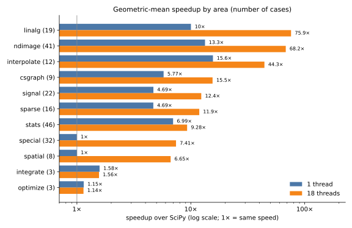
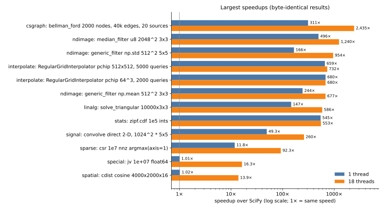

# fastscipy

Drop-in acceleration for [SciPy](https://scipy.org). Call `fastscipy.patch()`
and the SciPy functions you already use run faster, on one core and on many,
and return **exactly the same results, byte for byte**.

```python
import fastscipy
fastscipy.patch()

import scipy.ndimage                                  # your code is unchanged
smooth = scipy.ndimage.median_filter(image, size=3)   # 260 ms -> 0.8 ms
```

fastscipy replaces the slow parts of SciPy with Rust kernels and
multithreaded wrappers, and leaves everything else to SciPy:

- **Same results.** Each fast path reproduces SciPy's arithmetic, down to the
  order of additions and which operations are fused multiply-adds. 219
  benchmark cases and about 5,000 randomized tests compare the bytes against
  SciPy, and every test in SciPy's own 88,000-test suite that runs both with
  and without fastscipy has the same outcome.
- **Faster.** 5.2× faster on one thread and 17.5× on 18 threads (geometric
  mean over 211 benchmark cases), and hundreds of times faster for some
  functions.
- **Safe to switch on.** Any call a fast path does not cover (an unusual
  dtype, option or layout) goes to SciPy unchanged, so SciPy still produces
  every warning and error. `fastscipy.unpatch()` restores SciPy.
- **Works for libraries too.** `patch()` changes SciPy itself in the running
  process, so scikit-image, astropy and other libraries that call SciPy
  speed up as well.

**Status: experimental.** Validated on macOS arm64 (Apple Silicon) with
SciPy 1.18 and Python 3.12-3.14. On any other platform or SciPy version,
`patch()` leaves SciPy untouched (see [Platforms](#platforms)).

This is an independent project, not affiliated with the SciPy project.

[Quick start](#quick-start) · [Performance](#performance) ·
[What is covered](docs/coverage.md) · [How it works](docs/design.md) ·
[Benchmarks](bench/README.md) · [Contributing](CONTRIBUTING.md)

## Quick start

fastscipy is not on PyPI yet. Building it needs a Rust toolchain
([rustup](https://rustup.rs)):

```sh
pip install git+https://github.com/michael-L-i/fastscipy
```

Then, at the top of your program, before importing other libraries that use
SciPy:

```python
import fastscipy
print(fastscipy.patch())    # {'ndimage': 'on', 'special': 'on', 'stats': 'on', ...}
```

| API | |
|---|---|
| `fastscipy.patch(components=None, threads=None)` | patch all components, or the ones named; returns `status()` |
| `fastscipy.unpatch(components=None)` | restore SciPy |
| `fastscipy.status()` | `{component: "on" \| "off: <reason>"}` |
| `fastscipy.set_num_threads(n)` / `get_num_threads()` | thread budget; default all cores, or `FASTSCIPY_NUM_THREADS` |
| `with fastscipy.disabled():` | run SciPy's own code inside the block, for comparisons |
| `fastscipy.stats()` | per-function counts of calls that took a fast path or went to SciPy |

A component that cannot be enabled (for example on an unsupported SciPy
version) reports why in `status()`; `patch()` never raises for that.

## Performance



| Area | Cases | 1 thread | 18 threads | How |
|---|---:|---:|---:|---|
| ndimage | 41 | 13.3× | 68× | Rust filters, interpolation, morphology, labelling, measurements |
| linalg | 19 | 10.0× | 76× | stacks of small matrices without SciPy's per-matrix Python loop |
| interpolate | 12 | 15.6× | 44× | Rust spline and pchip kernels, query reordering |
| stats | 46 | 7.0× | 9.3× | lean small-call paths, Rust ranking, discrete tables |
| csgraph | 9 | 5.8× | 15.5× | Rust shortest paths and connected components |
| signal | 22 | 4.7× | 12.4× | small-call paths, per-channel threads, Rust kernels |
| sparse | 16 | 4.7× | 11.9× | Rust argmax, duplicate summing, dense conversion |
| special | 32 | 1.0× | 7.4× | SciPy's own ufunc loops on several threads |
| spatial | 8 | 1.0× | 6.7× | `cdist`, `pdist` and KD-tree queries on several threads |
| integrate, optimize | 6 | 1.1-1.6× | 1.1-1.6× | less Python overhead |



Measured on an Apple M5 Pro (18 cores) with SciPy 1.18.1, one benchmark at a
time; every case checks that the result is byte-identical to SciPy's. Small
calls that a fast path hands back to SciPy are included as controls and are
not slower. Full table: [bench/RESULTS.md](bench/RESULTS.md); method and how
to reproduce: [bench/README.md](bench/README.md).

The speed comes from three sources. SciPy's own C kernels (ndimage, sparse,
csgraph, signal) are mostly single-threaded and use little SIMD, so Rust
rewrites gain on one core and scale across cores. Some functions spend most
of their time in Python layers around a small computation (statistical
tests, filter design, batches of small matrices), which a lean path removes.
And some functions, such as the special functions and `cdist`, already run
in fast compiled loops and only gain from threads.

## What is covered

About 130 functions have their own fast path, plus all 322 `scipy.special`
ufuncs, which are threaded for large arrays. [docs/coverage.md](docs/coverage.md)
lists them by area, with the cases each one hands back to SciPy.

Sparse iterative solvers and clustering also have targeted Python dispatch
fast paths; their numerical algorithms remain SciPy's own.

Outside the current fast paths:

- **Already near the hardware limit:** large dense linear algebra and FFT
  (they call tuned BLAS/LAPACK and FFT libraries).
- **Other areas:** `linprog`/HiGHS and scientific `io`.
- **Time spent in your code:** `minimize`, `solve_ivp`, `quad`, `root` and
  similar solvers spend most of their time calling your Python function.

## Platforms

Byte-identical results depend on how SciPy's wheels were compiled: which
multiply-adds the compiler fused, and in what order the BLAS sums. fastscipy
reproduces the macOS arm64 wheels. On other platforms `patch()` turns
nothing on; `FASTSCIPY_ANY_PLATFORM=1` overrides that, for testing ports. A
[Linux workflow](.github/workflows/linux.yml) runs the identity tests there
to track what still differs. On Linux arm64, 4,875 of the 5,060 identity
tests pass; the rest are ndimage filters and interpolation, `find_peaks`,
the distance transform, `splev`, `LinearNDInterpolator` and `dlsim`, whose
last bits depend on how SciPy's Linux wheels fuse multiply-adds and sum in
BLAS.

Each component also refuses SciPy versions other than 1.18
(`FASTSCIPY_ANY_VERSION=1` overrides).

## Known differences

- While patched, `isinstance(scipy.special.erf, np.ufunc)` is `False`: the
  wrappers forward `nin`, `nout`, `types`, `reduce`, `outer` and the other
  ufunc attributes, but cannot be ufuncs. SciPy has 684 tests that select
  functions this way, and they are not collected under the patch.
- `scipy.spatial.cKDTree` is replaced by a subclass; `isinstance`, `issubclass`
  and pickling behave as before.
- Modules that ran `from scipy.x import f` before `patch()` keep the original
  `f`.

## Validation

- `tests/`: about 5,000 randomized tests compare each fast path with plain
  SciPy on 1 and several threads, including declined cases, and check that
  forked processes work after every thread pool has run.
- SciPy's own test suite: with every component patched, each of its ~88,000
  tests has the same outcome as without fastscipy, and 1.86 million calls
  took a fast path with no fast-path errors
  ([tools/scipy_suite.py](tools/scipy_suite.py)).
- CI runs the tests on macOS arm64 with Python 3.12, 3.13 and 3.14, and the
  SciPy-suite comparison with Python 3.13.

## Project layout

```text
python/fastscipy/     patch(), the thread budget, and one module per SciPy area (_ndimage.py, _stats.py, ...)
src/                  Rust kernels, one directory per area; src/pool.rs is the shared thread pool
tests/                identity tests against SciPy
bench/                benchmark cases, runner, results and charts
tools/scipy_suite.py  SciPy's test suite with and without fastscipy
docs/                 coverage list and design notes
```

## Contributing and license

See [CONTRIBUTING.md](CONTRIBUTING.md). fastscipy is BSD-3-Clause; parts are
ports of SciPy code, whose license is in
[LICENSES/scipy-LICENSE.txt](LICENSES/scipy-LICENSE.txt).
