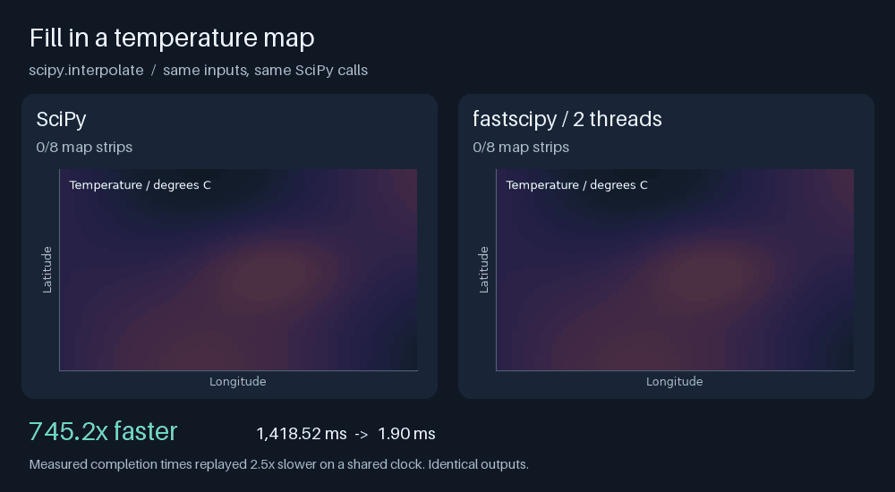
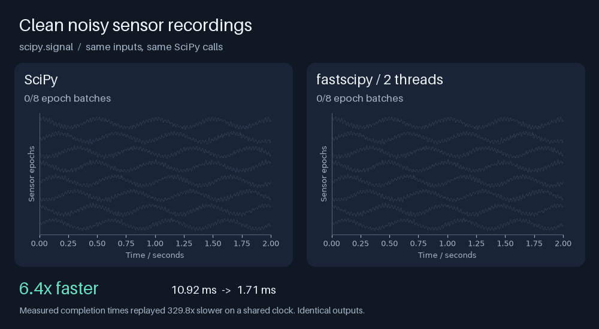
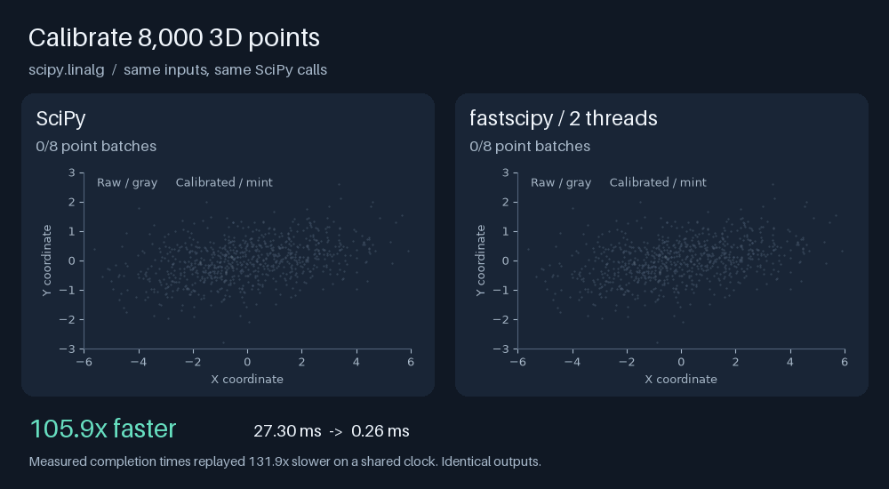
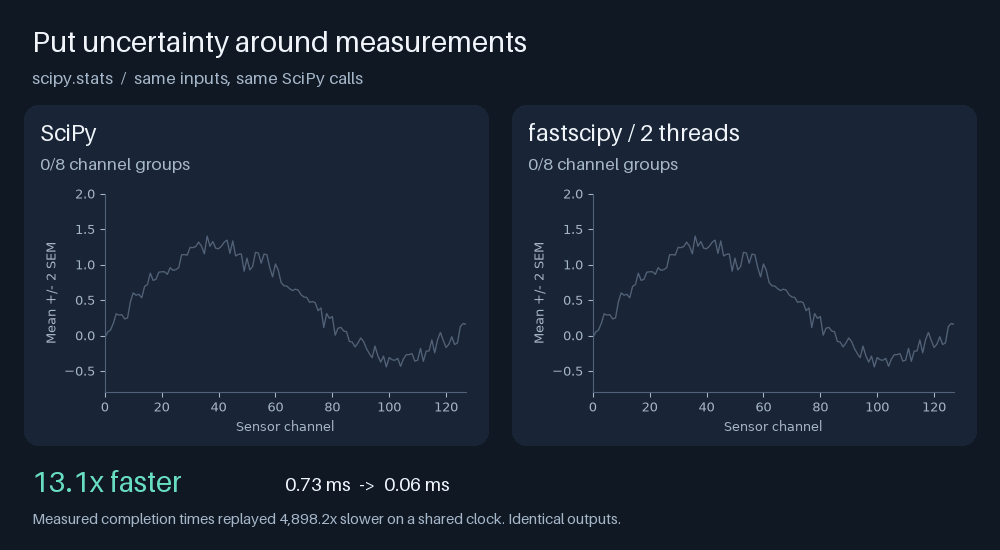
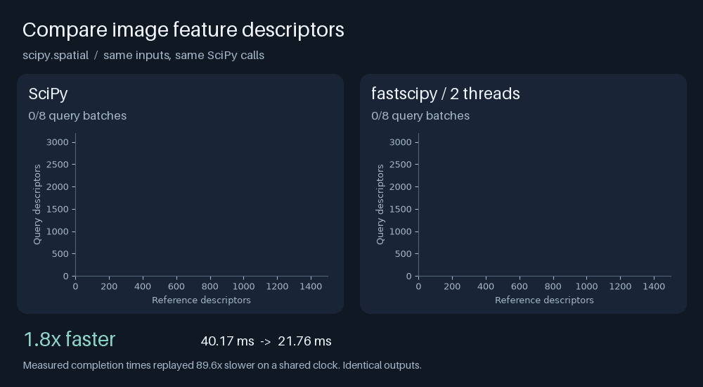
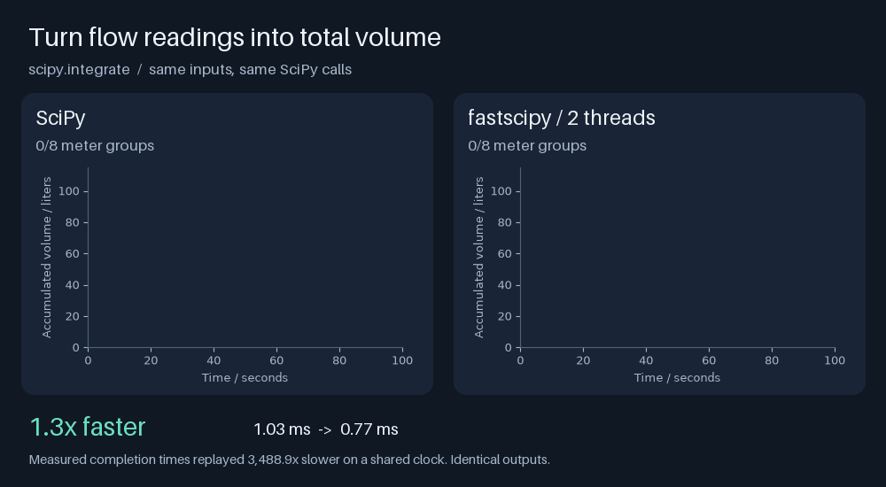
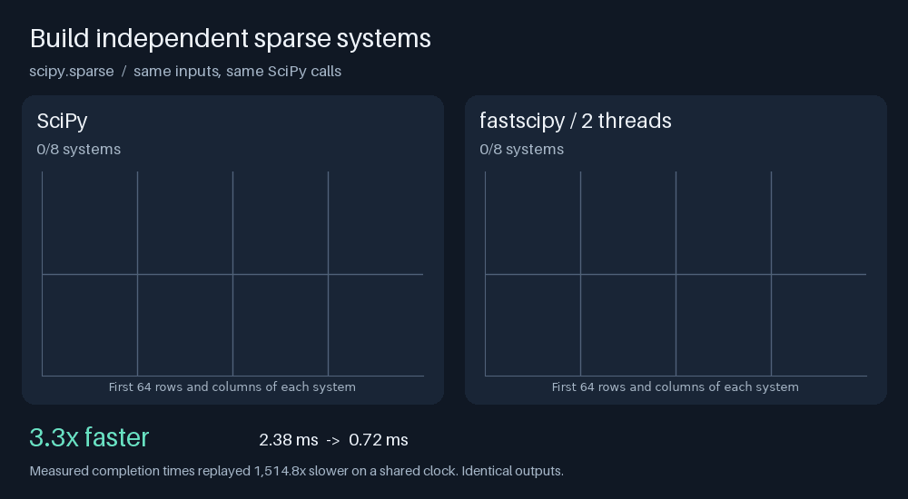
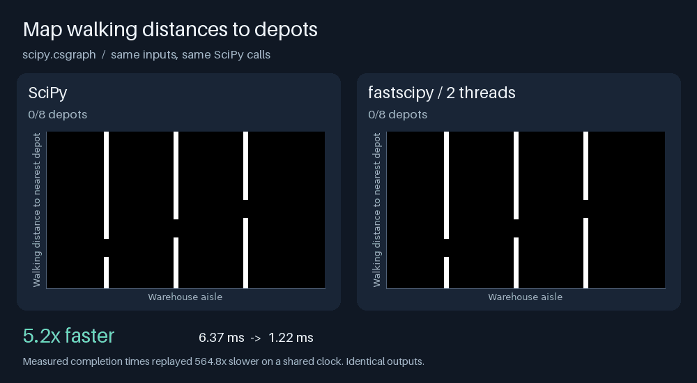

# Eight everyday SciPy tasks, faster

Same SciPy calls. Less waiting. Realistic tasks on reproducible synthetic data.

*Run on a MacBook Pro with M5 Pro, using two fastscipy threads.*

| Task | SciPy area | Speedup |
|---|---|---:|
| [Fill in a temperature map](#temperature) | `interpolate` | **745.2×** |
| [Clean noisy sensor recordings](#sensors) | `signal` | **6.6×** |
| [Calibrate 8,000 3D points](#calibration) | `linalg` | **111.8×** |
| [Put uncertainty around measurements](#uncertainty) | `stats` | **13.7×** |
| [Compare image feature descriptors](#descriptors) | `spatial` | **1.8×** |
| [Turn flow readings into total volume](#flow) | `integrate` | **1.3×** |
| [Build independent sparse systems](#systems) | `sparse` | **3.2×** |
| [Map walking distances to depots](#routes) | `csgraph` | **5.2×** |

<a id="temperature"></a>

## 1. Fill in a temperature map

Resample a 64 x 64 weather grid to 160 x 160 with shape-preserving PCHIP interpolation.

```python
model(points)  # prebuilt RegularGridInterpolator(method="pchip")
```



<a id="sensors"></a>

## 2. Clean noisy sensor recordings

Low-pass filter 128 four-second sensor epochs, preserving phase with forward-backward filtering.

```python
signal.sosfiltfilt(sos, epoch)
```



<a id="calibration"></a>

## 3. Calibrate 8,000 3D points

Correct scale and cross-axis coupling with a different 3 x 3 calibration system for each point.

```python
linalg.solve_triangular(calibration_matrices, observed_points)
```



<a id="uncertainty"></a>

## 4. Put uncertainty around measurements

Compute standard errors for 128 sensor channels, each measured 30 times.

```python
stats.sem(repeated_measurements, axis=0)
```



<a id="descriptors"></a>

## 5. Compare image feature descriptors

Compute cosine distances from 3,200 query descriptors to 1,500 references, with 32 features each.

```python
distance.cdist(query, reference, metric="cosine")
```



<a id="flow"></a>

## 6. Turn flow readings into total volume

Integrate 1,000 readings from each of 128 flow meters, using cumulative Simpson integration.

```python
integrate.cumulative_simpson(flow_rate, dx=0.1, initial=0)
```



<a id="systems"></a>

## 7. Build independent sparse systems

Assemble eight block-diagonal models from 192 small local coupling matrices.

```python
sparse.block_diag(local_models, format="csr")
```



<a id="routes"></a>

## 8. Map walking distances to depots

Find unweighted shortest paths from eight depots through a 120 x 120 warehouse with aisle barriers.

```python
csgraph.shortest_path(aisles, directed=False, unweighted=True, indices=depot)
```



---

Synthetic inputs, real timings. Each GIF replays measured completion times on a
shared clock; the slowdown is shown in the frame. Byte-identical outputs.

[Measured timings](measurements.json) · [Runnable source](gallery.py) · [Back to fastscipy](../README.md)

<details>
<summary>Run the gallery</summary>

From the repository root, with fastscipy installed:

```sh
pip install "pillow>=10.1" matplotlib
OPENBLAS_NUM_THREADS=1 OMP_NUM_THREADS=1 VECLIB_MAXIMUM_THREADS=1 python examples/gallery.py
```

Each lane uses the fastest of three warmed batches. Input setup and rendering
are outside the timer. Tasks run one at a time; results depend on hardware and inputs.

</details>
